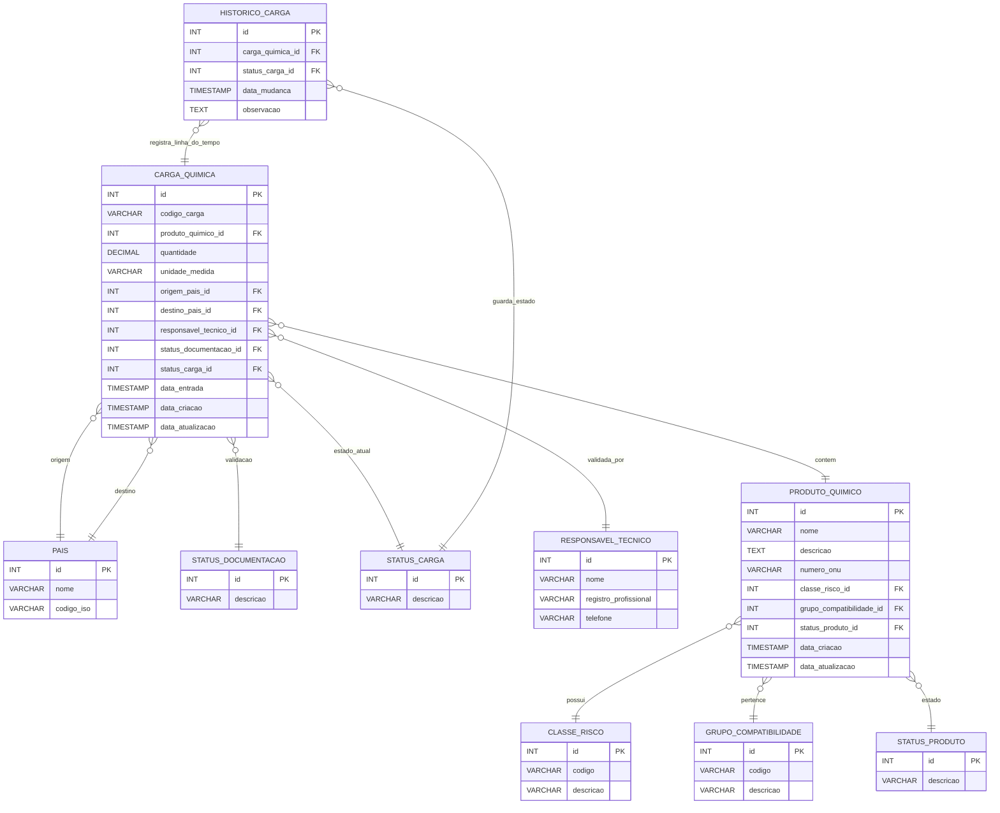

# QuimiPort - Sistema de Gestão de Cargas Químicas Portuárias

O **QuimiPort** é uma solução Full Stack desenvolvida para centralizar, monitorar e controlar todo o fluxo operacional relacionado ao gerenciamento de cargas químicas em ambiente portuário, inspirado nas operações logísticas do Porto de Santos. 

Esta é a primeira versão da API backend, entregue como o projeto **Tech Challenge 2 (TC2)** da pós-graduação **Pós Tech (FIAP)**. A aplicação automatiza validações críticas de segurança, controle documental e classificação de risco antes de qualquer movimentação física de substâncias químicas.

## 🚀 Tecnologias Utilizadas

*   **Runtime:** Node.js
*   **Banco de Dados:** Banco de Dados Relacional (SQL)
*   **Containerização:** Docker & Docker Compose
*   **Versionamento:** Git & GitHub

---

## 📦 Estrutura e Estado Atual do Projeto

O projeto encontra-se com sua arquitetura backend estruturada e ambiente de infraestrutura containerizado pronto para execução.

```text
quimiport-tech-challange-fase2/
├── .env                         # Variáveis de ambiente da aplicação
├── .gitignore                   # Arquivos ignorados pelo Git
├── Dockerfile                   # Definição da imagem Docker da API Node.js
├── docker-compose.yml           # Orquestração da API e do Banco de Dados
├── package.json                 # Definição de dependências do projeto
├── README.md                    # Documentação do projeto
├── database/
│   ├── connection.js            # Inicialização e pool de conexão com o banco
│   └── init/
│       └── quimiport_v1.sql     # Script completo unificado de DDL e carga inicial
├── docs/
│   └── sql/                     # Scripts isolados de tabelas e seeds (Fase 1/2)
│       ├── 01_pais.sql
│       ├── 02_status_carga.sql
│       ├── ...
│       └── 18_seed_historico_carga.sql
├── http/                        # Arquivos de testes manuais de requisições HTTP
│   ├── cargas.http
│   └── produtos.http
└── src/
    ├── app.js                   # Configuração e middlewares do Express/Fastify
    ├── server.js                # Inicialização do servidor HTTP
    ├── controllers/             # Camada de controle (Carga e Produto)
    ├── models/                  # Definição dos modelos e mapeamento de dados
    └── routes/                  # Definição dos endpoints REST
```

---

## 🗄️ Banco de Dados e Modelagem

A persistência utiliza uma modelagem relacional robusta. O banco de dados é inicializado e populado automaticamente através do script unificado localizado em `database/init/quimiport_v1.sql`.

### Diagrama de Entidade e Relacionamento (ERD)



### Detalhes das Entidades Principais:
*   **Produtos Químicos:** Cadastro de substâncias contendo metadados de risco fundamentais (Número ONU, Classe de Risco e Compatibilidade). Possui validação lógica de status ativo/inativo para novos registros de entrada.
*   **Cargas Químicas:** Entidade central da cadeia de suprimentos. Vincula a movimentação portuária à origem, ao destino, à documentação legal, à auditoria do técnico responsável e ao estado da esteira logística.
*   **Histórico da Carga:** Tabela de trilha de auditoria (event sourcing parcial), alimentando a máquina de estados sempre que houver mudanças de status.

---

## ⚙️ Como Executar o Projeto com Docker

Certifique-se de ter o **Docker** e o **Docker Compose** instalados em sua máquina de desenvolvimento.

### 1. Configurar as Variáveis de Ambiente
Verifique ou ajuste as credenciais de acesso e portas configuradas no arquivo `.env` localizado na raiz do projeto.

### 2. Inicializar o Ambiente Containerizado
Na raiz do projeto (onde está o arquivo `docker-compose.yml`), execute o comando abaixo no terminal:

```bash
docker compose down -v
docker compose up -d
```

Este comando irá:
1. Construir a imagem Docker da API Node.js a partir do `Dockerfile`.
2. Subir o contêiner do Banco de Dados Relacional.
3. Executar automaticamente o script `database/init/quimiport_v1.sql` criando todas as tabelas, relacionamentos e inserindo a massa de dados inicial (seeds).
4. Expor os serviços localmente prontos para receber conexões.

### 3. Testar os Endpoints REST
Com os contêineres ativos, você pode efetuar disparos manuais para validação dos fluxos utilizando os arquivos contidos na pasta `http/`:
*   `http/produtos.http` (Cadastro, listagem e inativação de produtos)
*   `http/cargas.http` (Registro, bloqueio, liberação e transições de status da carga)

---

## 🎯 Principais Endpoints Mapeados

### Produtos Químicos
*   `POST /produtos-quimicos` - Criar novo produto químico
*   `GET /produtos-quimicos` - Listar todos os produtos
*   `GET /produtos-quimicos/:id` - Buscar detalhes de um produto por ID
*   `PUT /produtos-quimicos/:id` - Atualizar informações do produto
*   `PATCH /produtos-quimicos/:id/inativar` - Alterar status para inativo

### Cargas Químicas
*   `POST /cargas-quimicas` - Registrar nova carga portuária
*   `GET /cargas-quimicas` - Listar todas as cargas
*   `GET /cargas-quimicas/:id` - Buscar carga por ID
*   `PATCH /cargas-quimicas/:id/status` - Atualizar transição de status
*   `PATCH /cargas-quimicas/:id/bloquear` - Bloquear carga por inconformidade
*   `PATCH /cargas-quimicas/:id/liberar` - Liberar carga mediante documentação
*   `PATCH /cargas-quimicas/:id/cancelar` - Cancelar carga operacionalmente

---

## 👥 Integrantes do Grupo
*   **Rodrigo Sampaio Vasconcelos**
